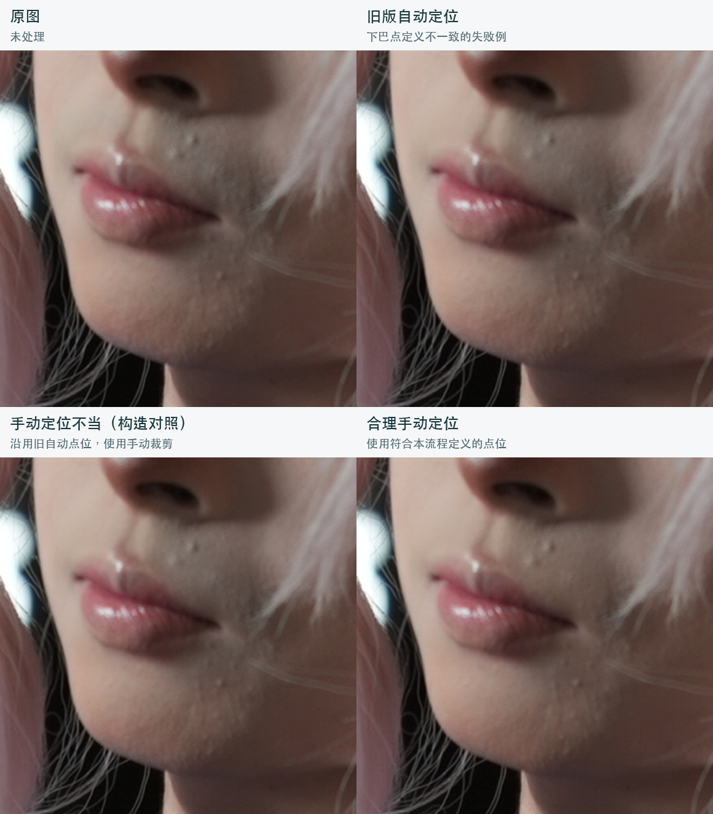

# FiveShadow • 胡青祛除算法

导入照片，自动定位人脸并修复胡青；也可手动框选脸部、标记两个嘴角和下巴。提供缩放、原图/结果对照、强度调整、PNG导出与命令行。照片在本机处理。

## 定位案例：合理选点能明显改善效果

自动处理后仍有明显胡青时，可以检查定位并改用手动选区。下面是同一张照片、同一个 **C 模型、100%修复强度** 的实际结果：合理手动定位后，残留胡青明显变淡。



左下是**构造对照**：在手动配置中沿用旧自动点位，展示手动选点不当也会使效果变差；并非一次用户误点的记录。右上是旧版自动定位的失败例，**当前版本已修正该自动选点规则**，修正后的自动C也获得了接近原手工结果的人工评价。

手动定位时，框住包含眉眼到下巴的整张脸，再依次标记**画面左嘴角、画面右嘴角、画面中下颌轮廓最低处**。侧脸时，第三点可能与前突的下巴尖不同。见[点位示意与案例说明](wiki/定位案例.md)。本例说明定位会影响结果，实际效果仍需结合照片判断。

## 启动界面

```sh
uv sync --locked
uv run stubble gui
```

也可双击根目录的 `启动.command`（macOS，需已安装uv）。Python 3.12由uv管理。当前目录带有所需模型；首次补齐自动定位模型时会从官方地址下载，照片不会上传。

## 命令行

```sh
# 自动选择面积最大的人脸；可加 --face-index 1 选择第二张脸
uv run stubble process --input /path/to/photo.jpg --output runs/photo

# 手动指定脸框与三点（画面左嘴角、右嘴角、下巴底点）
uv run stubble process --input /path/to/photo.jpg --output runs/manual \
  --box 2200 500 2850 1150 --points 2420 923 2528 936 2478 1010

# 可视化框选与点选，然后处理
uv run stubble gui /path/to/photo.jpg
```

输出目录必须是新目录，原图不会覆盖。详见 [使用说明](wiki/使用说明.md)。
