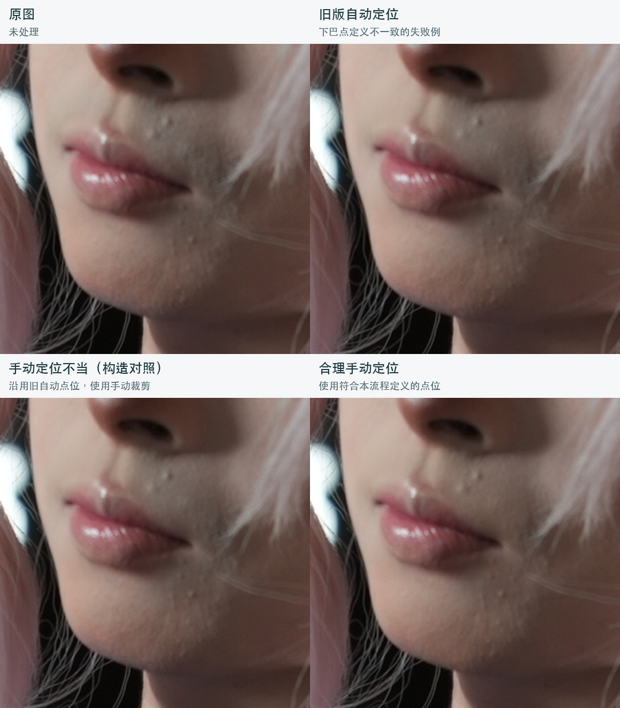
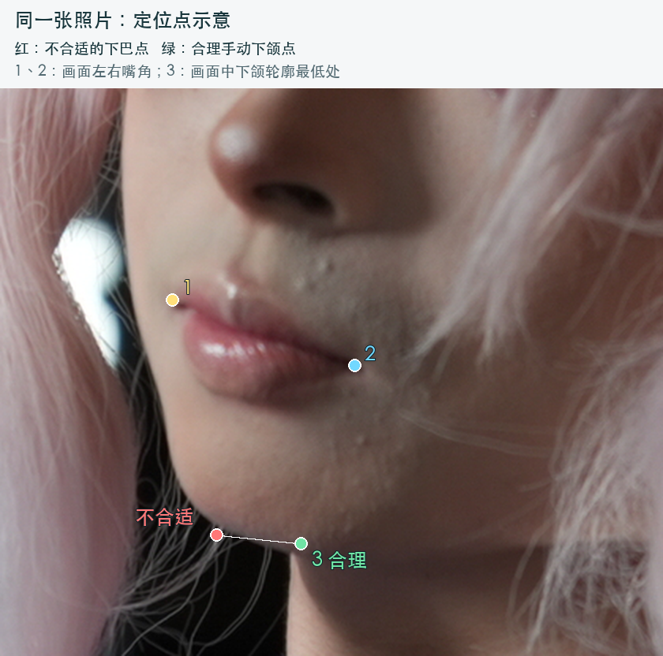

# 定位如何影响祛胡青：一个侧脸案例

## 效果对照

| 位置 | 条件 | 说明 |
| --- | --- | --- |
| 左上 | 原照片 | 未处理，保留原始胡青作参照 |
| 右上 | 旧版自动定位 | 使用的下巴点与本流程的手工定义不同，C修正偏弱 |
| 左下 | 手动定位不当，构造对照 | 沿用旧自动的三个点，使用合理手工配置的分割裁剪；没有重新模拟一次用户误点 |
| 右下 | 合理手动定位 | 使用与研究基线一致的三点和裁剪，胡青明显变淡 |

三个处理结果都使用同一张YS_02170原照片、同一C模型参数、强度1。四格统一裁剪原图像素区域 `(2490,880,2780,1170)`、放大2倍显示，没有额外调亮、调色或修图。左下与右下使用相同分割裁剪，差别是定位点；旧自动与手工配置的裁剪本身也有差别。

## 点位应该放在哪里

1. 脸框应包含眉眼、鼻子、嘴唇和下巴，不要只圈住胡青。
2. 点1、2分别是**画面方向**的左嘴角和右嘴角。
3. 点3放在**画面中下颌轮廓的最低处**。本例侧脸的解剖学下巴尖与这个位置不同，两个候选点横向相差约53个原图像素。

三点决定照片如何映射到模型的处理画布。偏移会改变模型看到的局部形状与位置；手动模式也需要符合本流程定义的点位。定位完成后可拖动彩色点微调，再重新生成比较。

## 当前版本已经修正自动规则

旧版自动定位固定使用MediaPipe152作为下巴点；当前版本改为从投影下颌轮廓估计最低处。修正后的自动C在本例获得用户评价：**“明显改善，已接近”原先认可的手工C结果**。

因此这张图不是当前自动模式必然失败的展示，也不支持所有照片上手工定位一定更好。建议先自动定位；如果仍有明显残留，检查并手动调整。旧配置保存的是当时点位，更新程序后需要再次自动定位才会应用新规则。

## 来源与复查

- 本例来源是已保存的真实处理产物，未为文档重跑修复模型。
- 图片与点位配置的来源哈希、实际模型和强度记录在 [例图清单](assets/02170-alignment-example.json)。
- 对照图生成脚本保存在实验仓库 `.analysis/build_readme_alignment_case.py`。
- 单变量实验、失败/修正回放和人工评价保存在实验仓库 `.analysis/product_geometry_diagnosis/`，诊断叙述为 `.analysis/产品自动定位差异-2026-10-15.md`。

原图不随例图复制到文档目录；此处只有说明所需的局部裁剪和点位标记。
